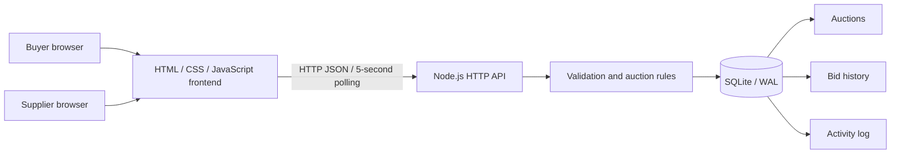

# High-level design

The browser renders listings, auction detail, RFQ creation and quote forms. The API owns time validation, pricing, rankings, status and extension decisions; clients cannot set auction status or bypass deadline rules. No scheduled background task is needed: status is derived from server time on every read and submission. SQLite serializes writes, and `BEGIN IMMEDIATE` keeps bid validation, insert, extension and audit log atomic. Five-second polling updates other open clients; countdowns update every second locally.

## Database schema

The implementation uses relational ownership keys with JSON payloads for compact, dependency-free storage. JSON documents are server validated. All business timestamps are UTC epoch milliseconds.

| Table | Column | Type / constraint | Meaning |
| --- | --- | --- | --- |
| auctions | id | INTEGER PRIMARY KEY | RFQ identity |
| auctions | reference | TEXT UNIQUE NOT NULL | Human RFQ reference |
| auctions | payload | TEXT NOT NULL (JSON) | name, reference, start, close, forcedClose, pickup, triggerWindow, extension, trigger, british |
| bids | id | INTEGER PRIMARY KEY | Bid identity and deterministic insertion order |
| bids | auction_id | INTEGER NOT NULL FK auctions(id) | Auction ownership |
| bids | payload | TEXT NOT NULL (JSON) | carrier, freight, origin, destination, total, transit, validity, created |
| activity | id | INTEGER PRIMARY KEY | Event identity |
| activity | auction_id | INTEGER NOT NULL FK auctions(id) | Auction ownership |
| activity | created | INTEGER NOT NULL | Server event time |
| activity | type | TEXT NOT NULL | created / bid / extension |
| activity | message | TEXT NOT NULL | Event detail and extension reason |

One auction has many bids and events. Historical quotes are immutable. A supplier's latest bid is selected before ranking; supplier records are identified by normalized carrier name for this assignment. In a scaled system, split supplier identities and payload fields into indexed typed columns and use integer cents for monetary values.

## API

| Method | Route | Behavior |
| --- | --- | --- |
| GET | /api/auctions | All auctions with current status, rankings, bids and activity |
| GET | /api/auctions/:id | Single auction details |
| POST | /api/auctions | Validate and create RFQ; return 201 |
| POST | /api/auctions/:id/bids | Submit quote and evaluate extension atomically; return 201 |

RFQ input: `name`, `reference`, `start`, `close`, `forcedClose`, `pickup` (ISO date strings), `triggerWindow`, `extension` (positive integer minutes), `trigger` (`bid`, `rank`, `leader`), `british` (boolean).

Bid input: `carrier`, `freight`, `origin`, `destination` (non-negative numbers), `transit` (positive integer days), `validity` (ISO date string covering the service date). Total is calculated server-side. Invalid requests return 400 with `{ "error": "..." }`; missing RFQs return 404. Request bodies are capped at 32 KB.

## Extension algorithm

1. Acquire the write transaction and read the current RFQ and bid history.
2. Reject submissions before start, at/after current close, or at/after forced close.
3. Validate the quote and ensure a supplier's revision lowers its previous total.
4. Compute rankings before and after the quote using latest bids per supplier.
5. Inside the final X minutes, evaluate the selected trigger.
6. Set `close = min(current close + Y minutes, forced close)` if triggered.
7. Insert the bid and activity events, update the close if changed, then commit. Roll back on failure.

Buyer savings and bid volume can be measured from retained historical bids. A production analytics pipeline could compare initial vs final L1 totals and bids per RFQ across auction configurations.
